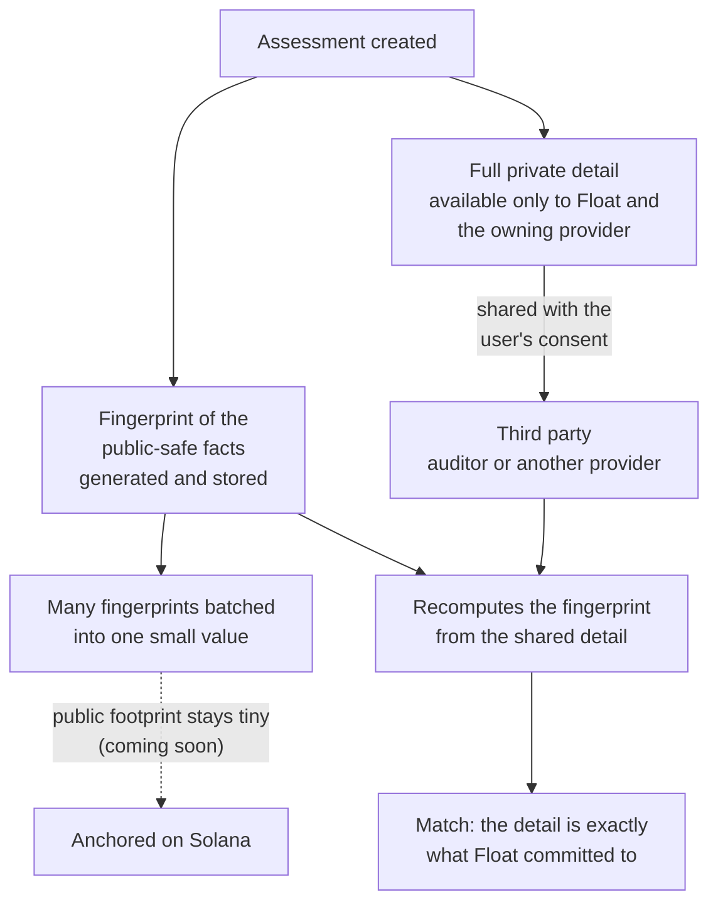
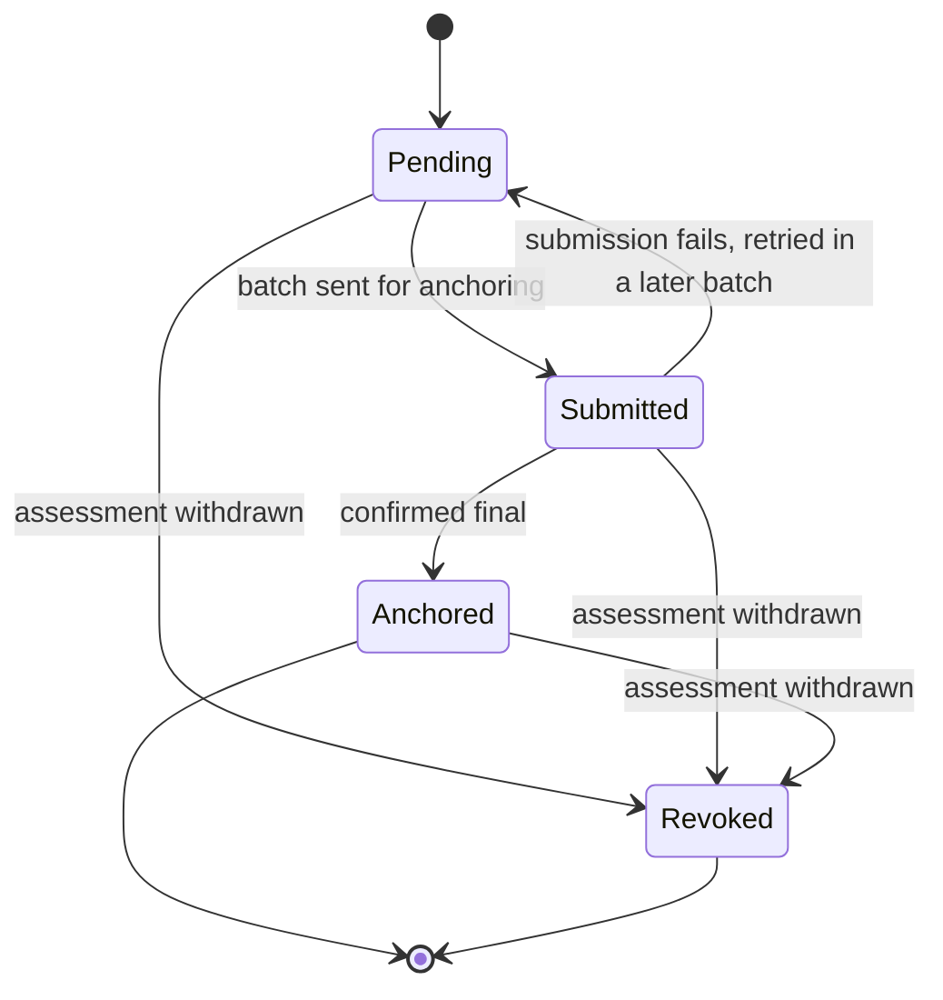

## Design principles

<CardGroup cols={2}>
  <Card title="Float manages the credit" icon="fa-solid fa-hand-holding-dollar">
    Float assesses, funds and collects. The infrastructure provider keeps running its service and takes no credit risk. Float's funding model will be published before launch.
  </Card>
  <Card title="Verified evidence only" icon="fa-solid fa-circle-check">
    Portable reputation is built only from repayment outcomes that Float's chain observer verifies on-chain, never from data an infrastructure provider reports.
  </Card>
  <Card title="Provider-scoped data" icon="fa-solid fa-lock">
    An infrastructure provider sees its own data, and only aggregate eligibility counts for its users. Individual assessments happen only after a user opts in by connecting its wallet and signing a message. The one deliberate exception is reputation, which is shared across providers with the user's consent.
  </Card>
  <Card title="Isolated environments" icon="fa-solid fa-flask">
    Devnet and mainnet are fully separate. Devnet data never mixes with mainnet data.
  </Card>
</CardGroup>

## Partner-reported state vs Float-verified evidence

The most important rule in Float.

| | Provider-reported data | Float-verified evidence |
|---|---|---|
| **Source** | Subscription records and usage data an infrastructure provider shares with Float | User repayments, seen on-chain by Float's chain observer |
| **Used for** | Assessment: eligibility and limits | Portable reputation |
| **Affects reputation?** | ❌ **Never** | ✅ **Yes, the only input** |

<CardGroup cols={3}>
  <Card title="Shared data stays shared data" icon="fa-solid fa-eye-slash">
    Subscription and usage records help Float assess a user. They never become reputation evidence.
  </Card>
  <Card title="Repayments come to Float" icon="fa-solid fa-book">
    Because users repay Float on-chain in USDC, Float's chain observer sees repayments directly rather than relying on anyone's report.
  </Card>
  <Card title="Enforced by the data layer" icon="fa-solid fa-database">
    The rule is built into how the data is stored, so it holds no matter how the rest of the system behaves.
  </Card>
</CardGroup>

<Note>
Float still records every repayment it collects. But a repayment counts as Float-verified reputation evidence only when Float's chain observer sees it on-chain. Where observation is off, repayments are marked as not verifiable and reputation stays empty. See the [Roadmap](/roadmap) for what is available today.
</Note>

## Verifiable assessments

Float can prove it issued a specific assessment, the exact outcome and terms, without putting any private user or invoice data anywhere public.

Only a small cryptographic **fingerprint** of the assessment's public-safe facts ever becomes public. The private detail stays with Float and the owning infrastructure provider. With the user's consent, it can be shared selectively with a third party, such as an auditor or another infrastructure provider. {/* TODO: confirm who owns private assessment detail */} That party can then check the detail they were shown against the fingerprint, **without taking Float's word for it**.

Fingerprints are batched, and each one gets a **proof** that it belongs to its batch. Only the single value that represents the whole batch is anchored publicly, so the public footprint stays tiny no matter how many assessments Float issues.

### Lifecycle

Every attestation moves through these states.

<Warning>
**On-chain anchoring is coming soon.** Fingerprints, batching, proofs and checking shared detail against a fingerprint are already in place. The on-chain step is still in the works, so every attestation currently stays at **Pending**. Revocation is part of the design and is coming soon too.
</Warning>

<CardGroup cols={2}>
  <Card title="Decision log" icon="fa-solid fa-scale-balanced" href="/decision-log">
    The decisions that matter most, and why.
  </Card>
  <Card title="Roadmap" icon="fa-solid fa-map" href="/roadmap">
    What is available now and what is coming next.
  </Card>
</CardGroup>
