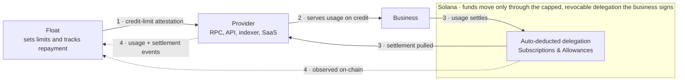

## What Float is

Float is plug-and-play programmable credit for onchain services. A provider (an RPC, API, indexer or SaaS company) integrates once and decides which of its customers can borrow. Float sets the limit and manages the credit line. Repayment is collected through a capped, revocable on-chain delegation on Solana that auto-deducts as the business uses the service. Each repayment is verified on-chain and builds the **Float Score**, a portable reputation that follows the business to the next provider. Stripe turned payment data into credit. Float does the same for any provider.

<Info>
**Float Score.** The portable reputation of a business, built only from repayments that Float verifies on-chain. Nothing a provider reports about a repayment counts toward it. The score output is still being built: the reputation `band` is `null` today, and what you can read is the underlying verified evidence. See the [Roadmap](/roadmap).
</Info>

<CardGroup cols={3}>
  <Card title="Sets limits" icon="fa-solid fa-sliders">
    Float scores the business and sends the provider a credit-limit attestation. The limit caps unsettled usage.
  </Card>
  <Card title="Tracks repayment" icon="fa-solid fa-receipt">
    Usage and settlement events flow back to Float. Float watches the delegation on-chain.
  </Card>
  <Card title="Builds the Float Score" icon="fa-solid fa-shield-halved">
    Verified on-chain repayments become a portable reputation, from evidence Float checks itself.
  </Card>
</CardGroup>

<Warning>
**Where funds move.** Funds move only through the capped, revocable delegation the business signs on Solana. The business can revoke it at any time. Float manages limits, repayment tracking and verification.
</Warning>

## Providers and businesses

<CardGroup cols={2}>
  <Card title="Providers" icon="fa-solid fa-server">
    Integrate once. Choose which customers can borrow, serve them on credit, and report usage. The provider is paid through the delegation.
  </Card>
  <Card title="Businesses" icon="fa-solid fa-store">
    Get credit they earn by paying on time. Each on-time repayment improves the Float Score and the terms offered by the next provider.
  </Card>
</CardGroup>

## Provider, Float, business

## The journey

<Steps>
  <Step title="Integrate once">
    The provider connects to Float with an API key and registers the businesses it serves. If another provider has already linked the same wallet, the business is linked to the same record. That wallet proof is the only way two providers share an identity.
  </Step>
  <Step title="Choose who can borrow">
    The provider decides which businesses are offered a credit line. Float does not choose for the provider.
  </Step>
  <Step title="Set a limit">
    The provider submits a credit-line request. Underwriting is asynchronous: you get an immediate acknowledgement and the result follows. Float returns an assessment with a risk band, confidence and reason codes, and opens a credit facility with an approved limit, the connected provider and a reset cadence.
  </Step>
  <Step title="Business approves a capped delegation">
    The business signs an on-chain delegation that caps what can be pulled and that it can revoke at any time.
  </Step>
  <Step title="Usage and repayment auto-deduct">
    The provider serves usage on credit. Settlement is pulled automatically through the delegation, up to its cap.
  </Step>
  <Step title="Float verifies on-chain">
    Float observes each settlement, and each failed pull, on Solana. Only what Float observes itself counts as verified.
  </Step>
  <Step title="The Float Score updates">
    Verified outcomes update the business's reputation, which the next provider can read with the business's consent. It never exposes amounts or providers. The score output is still being built.
  </Step>
</Steps>

## Provider-reported vs Float-verified

<CardGroup cols={2}>
  <Card title="Provider-reported" icon="fa-solid fa-pen-to-square">
    Everything a provider sends about usage or repayment. Drives **the provider's** bookkeeping. Never affects the Float Score.
  </Card>
  <Card title="Float-verified" icon="fa-solid fa-circle-check">
    What Float observes itself, on-chain. The **only** input to the Float Score.
  </Card>
</CardGroup>

See [Architecture](/architecture) for the full rule.

## Environments and access

<Warning>
**Float is pre-launch.** Every environment Float runs today is staging, whatever it is called in infrastructure or configuration. Names are not a signal of real-money readiness. Don't treat anything here as production-ready.
</Warning>

Your API key decides the environment, and test and live data never mix.

| | Test keys (`fk_test_…`) | Live keys (`fk_live_…`) |
|---|---|---|
| Underwriting | Sandbox. Mock results, not real assessments | Not available. Requests return `503` |
| Chain observation | Solana devnet | Not enabled |
| Document uploads | Not available yet (`503`) | Not available yet (`503`) |

See the [Roadmap](/roadmap) for the full list of what is real, and the [sandbox note](/get-started#sandbox) for testing with a test key.

**Getting credentials.** There is no self-serve signup yet. To get provider credentials today, contact the Float team directly.

## Integration at a glance

<AccordionGroup>
  <Accordion title="Authentication and environments">
    Requests are authenticated with a bearer API key. The key's prefix selects the environment.
  </Accordion>
  <Accordion title="Idempotency">
    Send an idempotency key on create requests so retries never duplicate. Replaying a key with the same body returns the original result; reusing it with a different body is rejected.
  </Accordion>
  <Accordion title="Events">
    Providers can poll an ordered event feed or receive signed webhooks carrying the same events.
  </Accordion>
  <Accordion title="Money and IDs">
    Money is an integer in minor units, sent as a string with a currency. IDs are prefixed (`biz_`, `uwr_`, `obl_`) and stable forever.
  </Accordion>
</AccordionGroup>

Exact endpoints are on hold while the API is finalized. See [API Reference](/api-reference).
