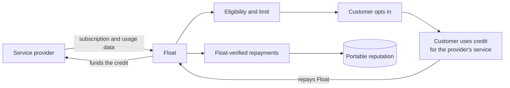

Float is cross-platform credit infrastructure for any app providing a service or subscription on Solana. The provider keeps running its service and shares data. Float manages the whole credit lifecycle:

<CardGroup cols={3}>
  <Card title="Assessment" icon="fa-solid fa-file-invoice-dollar">
    Float works out which of a provider's customers are eligible for credit, and sets their limits automatically.
  </Card>
  <Card title="Funds" icon="fa-solid fa-hand-holding-dollar">
    Float extends the credit and provides the funds. The provider is paid as normal.
  </Card>
  <Card title="Repayment" icon="fa-solid fa-receipt">
    Customers repay Float. Float handles schedules, reminders and collection, and builds reputation from verified outcomes.
  </Card>
</CardGroup>

<Note>
Float's funding model will be published before launch.
</Note>

## Two products, one platform

| | Credit lines | Invoice financing |
|---|---|---|
| What it is | Ongoing credit for a customer's use of an API or RPC service | Float pays the provider's invoice, and the customer repays Float over time |
| How repayment works | Settled automatically through a Solana delegation the customer controls | The customer repays Float over time |

Both use the same assessment, consent and reputation.

## Who does what

<CardGroup cols={3}>
  <Card title="Service provider" icon="fa-solid fa-server">
    Integrates Float, shares subscription and (optionally) usage data, can set stricter rules, and surfaces credit offers to its customers.
  </Card>
  <Card title="Float" icon="fa-solid fa-shield-halved">
    Assesses, decides eligibility and limits, funds the credit, collects repayments, records invoices and builds reputation.
  </Card>
  <Card title="Customer" icon="fa-solid fa-store">
    Opts in, accepts the terms, uses the credit and repays Float.
  </Card>
</CardGroup>

## Two layers of eligibility

<CardGroup cols={2}>
  <Card title="Layer 1: Instant insight" icon="fa-solid fa-bolt">
    One API call shows how many of your customers are likely eligible for credit, and why.
  </Card>
  <Card title="Layer 2: Deeper assessment" icon="fa-solid fa-user-check">
    When a customer opts in, Float looks closer and sets their limit.
  </Card>
</CardGroup>

Float's baseline is high. Providers can make it stricter, never looser.

## Partner-reported vs Float-verified

<CardGroup cols={2}>
  <Card title="Partner-reported" icon="fa-solid fa-pen-to-square">
    Subscription records and usage data shared by the provider. They feed **assessment** only, and never reputation.
  </Card>
  <Card title="Float-verified" icon="fa-solid fa-circle-check">
    Repayments that Float observes itself, on-chain. They are the **only** input to portable reputation.
  </Card>
</CardGroup>

## The partner journey

Float works with any service on Solana that bills for access. If your service keep subscription or usage records, you can plug into Float. No changes to your billing stack are needed.

<Steps>
  <Step title="Connect to Float">
    The provider connects once using API keys issued for its own tenant. Every request and query is scoped to that provider, so one provider can never see another's data. Test and live keys are kept separate, and their data never mixes.
  </Step>
  <Step title="Send subscription events">
    The provider streams subscription events through the event ingestion API, or backfills its history in bulk. Each event carries a unique `event_id`. Users/Businesses are identified by a hashed, pseudonymous `customer_ref`, so Float never needs names or emails at this stage.
  </Step>
  <Step title="Add custom fields (optional)">
    Providers can attach their own fields to any event under `properties`, such as cluster, region, payment method or referral source. 
  </Step>
  <Step title="Configure eligibility rules">
    Providers decide how subscription history is counted. That includes what "subscribed X times" means: whether renewals count, or only new starts and reactivations. They can also tighten limits and choose which plans can be financed. Rules can be stricter than Float's baseline, never looser.
  </Step>
  <Step title="See aggregate eligibility">
    Float returns how many of the provider's businesses are likely eligible, near-eligible or not eligible, with reason codes. Results can be broken down by plan or by any custom field. 
  </Step>  
  <Step title="Credit offer">
    The provider shows credit offers to its likely-eligible users in one of three ways, in the same way providers integrate payments with Stripe:

    - **Hosted page**: link users to a Float-hosted credit page. Float handles the offer, terms, wallet connection and opt-in, then returns the user to the provider's app.
    - **Embedded components**: drop Float's prebuilt components into the provider's own dashboard, such as an eligibility banner, an offer card and an opt-in flow. They can be styled with the provider's logo, colours, fonts and copy.
    - **Custom build**: use the Float API directly to build the offer in the provider's own UI, CLI or app, and receive results through webhooks.

    Whichever option the provider picks, Float runs the credit itself.
  </Step>
  <Step title="The user opts in">
    The user/business connects its wallet, signs a message to accept the terms, and agrees to a further assessment. Only then does Float read that business's usage rollups to confirm it is actively building and not an idle subscription.
  </Step>
  <Step title="Final decisions">
    Float returns its decision and the business's limit, with reason codes. Updates arrive through an ordered event feed or signed webhooks.
  </Step>
  <Step title="Credit usage">
    Float funds the credit, and the provider is paid for the service on [SETTLEMENT_CYCLE].
  </Step>
  <Step title="Repayments">
    Float handles schedules, reminders and collection. For credit lines, repayment settles on-chain in USDC through an SPL token delegation the business controls.
  </Step>
  <Step title="Reputation grows">
    Float's chain observer verifies each repayment on-chain and builds portable reputation from it. Reputation never includes amounts, providers or invoices, and is read only with the business's consent.
  </Step>
</Steps>

<Note>
**How Float handles provider data.** Data is isolated per provider at the query level. Business identifiers are pseudonymous hashes. Usage is shared as daily aggregates only, never request payloads or end-user IP addresses. Each provider signs a data processing agreement that sets out how Float handles personal data, including under laws such as Malaysia's PDPA and the GDPR. Event storage is append-only, and is built to handle the high event volumes of busy RPC and data services.
</Note>

## Availability and access

<Warning>
**Float is pre-launch.** Every environment Float runs today is staging, whatever it is called internally. Nothing is open for developer testing yet, and nothing here should be treated as production-ready.
</Warning>

Float is being built with a small group of early partners. While it is pre-launch:

- Test and live environments are kept fully separate, and their data never mixes.
- On-chain observation is limited to Solana devnet.
- Self-serve signup is not available.

See the [Roadmap](/roadmap) for what is available now and what is coming.

**Getting involved.** To talk about early partnership, contact the Float team directly.

## Working with Float

A few principles hold across every part of the platform:

<CardGroup cols={2}>
  <Card title="Safe to retry" icon="fa-solid fa-rotate">
    Requests that create things can be repeated without creating duplicates.
  </Card>
  <Card title="Ordered updates" icon="fa-solid fa-bell">
    Partners can follow an ordered feed of events or receive signed notifications carrying the same events.
  </Card>
  <Card title="Exact amounts" icon="fa-solid fa-coins">
    Money is always handled in whole minor units, such as cents, together with a currency.
  </Card>
  <Card title="Stable identifiers" icon="fa-solid fa-fingerprint">
    Every business, assessment and invoice has an identifier that never changes.
  </Card>
</CardGroup>

Technical details will be published in the [API Reference](/api-reference) once the API is finalized.
