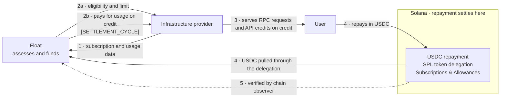
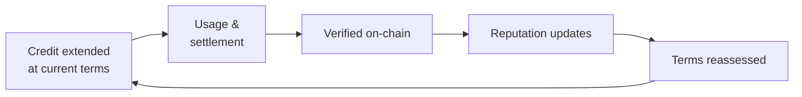
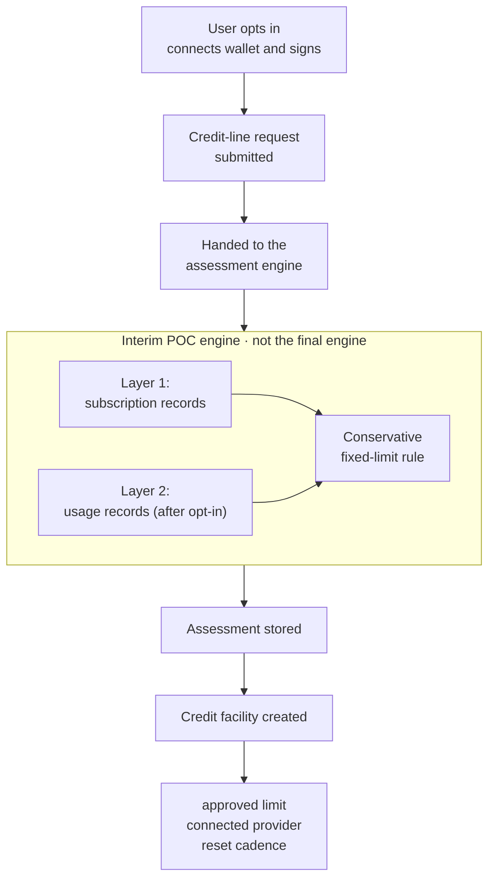
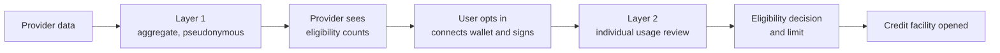

This page describes the proof-of-concept credit-line flow for infrastructure providers on Solana: RPC providers, indexers, data APIs, and oracle and streaming services. In this flow Float assesses the user, extends the credit and collects repayment. The credit-line mechanics (facilities, usage, limits, settlements and on-chain observation) are in place. The assessment step uses an interim engine while the final one is in the works. See the [Roadmap](/roadmap) for the full picture.

<CardGroup cols={4}>
  <Card title="Relationship" icon="fa-solid fa-handshake" href="#infrastructure-provider-float-user">
    Who does what
  </Card>
  <Card title="Tiers" icon="fa-solid fa-stairs" href="#tiers-for-higher-limits">
    How limits grow
  </Card>
  <Card title="Assessment" icon="fa-solid fa-scale-balanced" href="#assessment">
    Interim engine
  </Card>
  <Card title="Eligibility" icon="fa-solid fa-user-check" href="#credit-eligibility-coming-soon">
    Coming soon
  </Card>
</CardGroup>

## Infrastructure provider, Float, user

The core credit-line relationship. Float assesses the user, a team, dApp or protocol building on the provider, and sets its limit. The user then uses the provider's service on credit, and Float pays the provider for that usage [SETTLEMENT_CYCLE]. The user repays Float on-chain in USDC, through an SPL token delegation it controls. That is a standard Solana permission that lets an approved party pull up to an agreed amount of a token from a wallet, and nothing more. Float's chain observer, the component that watches Solana for these repayments, verifies them and updates reputation.



<CardGroup cols={3}>
  <Card title="Float" icon="fa-solid fa-shield-halved">
    Assesses, sets limits, pays the provider for usage on credit and collects repayment. Reputation is built from the repayments its chain observer verifies on-chain.
  </Card>
  <Card title="Infrastructure provider" icon="fa-solid fa-server">
    Shares subscription and usage data, serves the user, and is paid by Float [SETTLEMENT_CYCLE]. The limit caps **unsettled usage**, and the provider takes no credit risk.
  </Card>
  <Card title="User" icon="fa-solid fa-store">
    Connects its wallet, signs a message to opt in, and uses the service on credit. It repays Float in USDC through a delegation it controls.
  </Card>
</CardGroup>

<Note>
Float extends the credit here, not the provider. Float's funding model will be published before launch.
</Note>

## Tiers for higher limits

Limit and rate move together as a function of settlement history. Each clean cycle earns better terms, but the step gets smaller as the streak lengthens. There is little information early, so the first moves are big. Once there is a track record, the same evidence moves the terms less.



| Stage | Limit | Fee | Step in limit |
|---|---|---|---|
| Starting terms | $1,000 | 3.0% | n/a |
| After one clean cycle | $2,500 | 2.5% | +$1,500 (+150%) |
| After two clean cycles | $3,500 | 2.2% | +$1,000 (+40%) |

<Note>
These numbers are **illustrative**. Today's first version of credit reputation counts only settled periods and failed settlement pulls, observed on-chain. See the [Roadmap](/roadmap) for what the next version still has to decide.
</Note>

## Assessment

How a credit-line request becomes an assessment, and then a credit facility. A request is submitted only after the user has opted in by connecting its wallet and signing a message.



<Steps>
  <Step title="Opt in">
    The user connects its wallet and signs a message to accept further assessment. Nothing individual is reviewed before this.
  </Step>
  <Step title="Submit">
    The credit-line request is submitted. It is acknowledged immediately and processed in the background.
  </Step>
  <Step title="Hand-off">
    Float passes the request to the assessment engine.
  </Step>
  <Step title="Interim assessment">
    The proof-of-concept engine takes both layers of data and applies a conservative fixed-limit rule. The final engine is in the works.
  </Step>
  <Step title="Store and open the facility">
    The assessment is stored, and a credit facility is created with its approved limit, connected provider and reset cadence.
  </Step>
</Steps>

<Note>
This is the **interim** version. The final engine and risk band taxonomy are still being decided.
</Note>

## Credit eligibility (coming soon)

<Warning>
**In the works.** Eligibility checks are not available yet. All field names, event types and endpoints below are **illustrative** until the API reference is published. `[API_BASE_URL]` stands in for the real address.
</Warning>

Eligibility is checked in two layers, summarised in [Two layers of eligibility](/overview#two-layers-of-eligibility). Layer 1 uses subscription records, which every infrastructure provider already keeps, to find likely-eligible users in aggregate. Layer 2 starts only after a user opts in. It looks closely at how the user actually uses the provider's RPC and APIs, to confirm it is a real, active user building on-chain, not an account paying for a plan it doesn't use.



### Layer 1: Subscription records

**How Float gets the data.** There are three ways in.

<CardGroup cols={3}>
  <Card title="Event ingestion API (push)" icon="fa-solid fa-arrow-right-to-bracket">
    The provider sends subscription events as they happen.
  </Card>
  <Card title="Bulk import (backfill)" icon="fa-solid fa-file-import">
    A one-time upload of historical billing records, so a provider can see eligibility counts before a full integration.
  </Card>
  <Card title="Billing connectors (planned)" icon="fa-solid fa-plug">
    Connect an existing billing system and pull history automatically. Planned, not yet in the works.
  </Card>
</CardGroup>

**User identity in Layer 1.** Providers send a pseudonymous `customer_ref`, such as a hashed account ID, for each user. The field keeps that name, but it always identifies a user. Float doesn't need names, emails or wallet addresses at this layer.

**The subscription event.** An illustrative example:

```json
{
  "event_id": "evt_01J9...",
  "event_type": "subscription.renewed",
  "customer_ref": "prj_9f2b7e...",
  "plan_id": "business_monthly",
  "amount_minor": 499000000,
  "currency": "USDC",
  "period_start": "2026-09-01T00:00:00Z",
  "period_end": "2026-10-01T00:00:00Z",
  "occurred_at": "2026-09-01T00:00:04Z",
  "properties": {
    "payment_method": "usdc_solana",
    "cluster": "mainnet",
    "region": "APAC"
  }
}
```

| Field | Required | Description |
|---|---|---|
| `event_id` | Required | Unique per provider. Makes ingestion safe to retry, because duplicates are ignored. |
| `event_type` | Required | One of the event types below. |
| `customer_ref` | Required | A pseudonymous, stable ID for the user. |
| `plan_id` | Required | The provider's plan or tier identifier, such as Developer, Business or Professional. |
| `amount_minor` and `currency` | Required for paid events | Whole minor units. USDC uses 6 decimal places, so 499 USDC is `499000000`. |
| `period_start` and `period_end` | Required for paid periods | The period the payment covers. |
| `occurred_at` | Required | When the event happened. |
| `properties` | Optional | Any custom fields the provider wants to include, such as payment method, cluster or region. Providers can optionally register a schema for these fields so values stay consistent. |

| Event type | Meaning |
|---|---|
| `subscription.started` | A user starts a plan. |
| `subscription.renewed` | A plan renews for another period. |
| `subscription.upgraded` | A user moves to a higher tier. |
| `subscription.downgraded` | A user moves to a lower tier. |
| `subscription.cancelled` | A user cancels its plan. |
| `subscription.reactivated` | A cancelled plan is restarted. |
| `payment.failed` | A payment for a plan did not go through. |
| `payment.refunded` | A payment was returned to the user. |

**What Float derives from the records.** Float turns each user's event history into signals, for example:

- Tenure: time since the first subscription
- Paid cycles completed, and the current renewal streak
- Failed payments and refunds, especially recent ones
- Plan trajectory: upgrades versus downgrades between tiers
- Spend level and consistency
- Cancellations and reactivations

**What the provider sees.** Aggregate results only, with reasons: likely eligible, near-eligible (for example, one paid cycle short) and not eligible, grouped by reason code. Providers never see an individual user's assessment at this layer. An illustrative response:

```json
{
  "as_of": "2026-10-20",
  "users_assessed": 1240,
  "status_counts": {
    "likely_eligible": 310,
    "near_eligible": 185,
    "not_eligible": 745
  },
  "top_reasons": [
    { "code": "RENEWAL_STREAK_TOO_SHORT", "count": 402 },
    { "code": "RECENT_FAILED_PAYMENT", "count": 168 },
    { "code": "TENURE_TOO_SHORT", "count": 121 }
  ],
  "breakdown_by": "plan_id"
}
```

Breakdowns by plan, or by a custom `properties` field, are optional. The numbers above are made up for illustration.

The criteria for each status are [ELIGIBILITY_THRESHOLDS]. Thresholds are deliberately high. Providers can set stricter rules, such as tighter limits or which plans can be financed, but can't loosen Float's baseline.

### Layer 2: Service usage (after opt-in)

**When it starts.** Only after the user opts in by connecting its wallet and signing a message to accept further assessment. Only then does Float look at that user's individual usage records.

**Why it matters.** A subscription shows that a user pays. Usage shows whether it actually builds on the service. Layer 2 separates active, legitimate users from idle accounts, and from accounts trying to game eligibility.

**How Float gets usage data.** The provider sends daily usage rollups per user through the same ingestion API, using an event type like `usage.daily`. An illustrative example:

```json
{
  "event_id": "use_2026-10-20_prj_9f2b7e",
  "event_type": "usage.daily",
  "customer_ref": "prj_9f2b7e...",
  "date": "2026-10-20",
  "metrics": {
    "rpc_requests": 1843220,
    "credits_used": 2210000,
    "plan_credit_quota": 3000000,
    "mainnet_share": 0.94,
    "error_rate": 0.012,
    "active_api_keys": 3,
    "webhook_deliveries": 48210,
    "stream_hours": 22.5
  },
  "methods": {
    "getTransaction": 902110,
    "getAccountInfo": 511004,
    "getProgramAccounts": 120443,
    "getSignaturesForAddress": 98012,
    "sendTransaction": 40122
  }
}
```

- `metrics` holds standard counters, such as RPC requests, API credits, mainnet share, error rate, webhooks and streams (gRPC and WebSocket). Providers can add their own.
- `methods` is an optional per-method split of RPC requests.
- Float asks for daily aggregates only. It never receives request payloads, end-user IP addresses or the contents of calls.

**What Float looks for.** These are signals that inform the assessment, not automatic rules.

| Signs of an active user | Signs of an idle or risky user |
|---|---|
| Steady RPC traffic on most days | A paid plan with near-zero mainnet traffic |
| Most traffic on mainnet | Traffic only on devnet |
| A realistic method mix: reads like `getAccountInfo` and `getTransaction` alongside writes like `sendTransaction` | Only trivial polling methods, such as `getHealth` and `getSlot` |
| API credits used in proportion to the plan | A sudden spike just before applying |
| Live webhooks or streams | Very uniform, bot-like patterns |
| A connected wallet with real on-chain history, such as deployed programs and regular transactions | Several accounts tied to the same wallet, which may be Sybil behaviour |
| | A fresh wallet with no on-chain history |

**Result.** Layer 2 confirms or adjusts the Layer 1 outcome. The user gets a final eligibility decision, a limit and reason codes, and a credit facility is opened.
